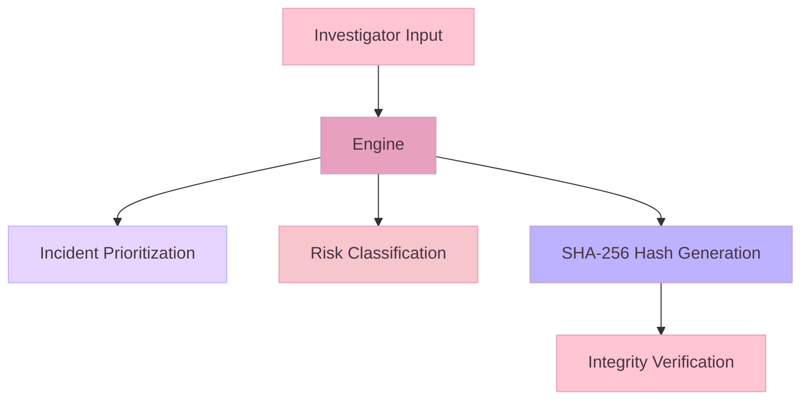

<div align="center">


Cybersecurity app/website in the works. I created this project to show off, develop, and refresh a few skills. I went through a lengthy process, please read the README section for a full analysis. This report will be updated every time a change has been committed within this repository. Thank you. 

<div align="center">


<h3>୨୧ Digital Forensics & Incident Intelligence ୨୧</h3>

<i>Every byte leaves a trace. A Digital Project by Kayla Alexis Hicks <3 </i>

  &nbsp;&nbsp;
  
</p>


<p align="center">
  
  
  
  
</p>

<p align="center">
  
  
  
</p>

<p align="center">
  ⊹ ─────────────── ୨୧ ─────────────── ⊹
</p>

<p align="center">
  <a href="#01-about-traceflow">Overview</a> ♡
  <a href="#02-core-functionality">Features</a> ♡
  <a href="#03-technical-architecture">Architecture</a> ♡
  <a href="#07-getting-started">Installation</a> ♡
  <a href="#09-development-roadmap">Roadmap</a>
</p>

---

## 01. About this Project


This project is Python-based, fully developed within my own Host PC. Here are the materials I have used/will use. 
VS CODE
PYTHON
PowerShell
SHA-256 
Streamlit
SQLite

The project combines cybersecurity fundamentals with
practical software engineering to do the following:
- Demonstrate an intermediate-level understanding of coding with Python
- Add a level of creativity to Cybersecurity projects
  

One of my many long-term goals is to establish my own digital forensics
company. This represents the beginning of my journey
toward developing independent cybersecurity software.

**Mission:** Investigate intelligently. Preserve evidence.
Follow the trace.

<br clear="both"/>

---

## 02. Core Functionality

| Feature | Description | Status |
|---|---|---|
| Incident Intelligence | Weighted incident prioritization algorithm | Implemented |
| Risk Classification | Automated severity categorization | Implemented |
| Cryptographic Hashing | SHA-256 digital fingerprint generation | Implemented |
| Integrity Verification | Comparison of original and current hashes | Implemented |
| Investigation Dashboard | Interactive graphical interface | Planned |
| Evidence Registry | Organized evidence records | Planned |
| Case Management | Persistent investigation storage | Planned |
| Chain of Custody | Timestamped evidence handling records | Planned |
| Forensic Reporting | Automated investigation reports | Planned |

---

## 03. Technical Architecture

This project follows a modular software architecture designed
to separate application logic, user interaction, and
persistent data storage.

Here are the directories within my file:

```text
TraceFlow/
│
├── engine.py              # Intelligence & cryptography
│
├── app.py                 # User interface [Planned]
│
├── database.py            # Data persistence [Planned]
│
├── test_engine.py         # Unit testing [Planned]
│
├── .streamlit/
│   └── config.toml        # Custom interface [Planned]
│
├── screenshots/           # Experimental documentation
│
├── requirements.txt       # Dependencies [Planned]
│
└── README.md              # Project documentation
```

### Application Workflow



---

## 04. Incident Intelligence Engine

The incident prioritization engine utilizes a custom
weighted scoring algorithm to determine the relative
priority of cybersecurity investigations.

The algorithm evaluates three analyst-provided factors.

| Factor | Description | Weight |
|---|---|---:|
| Severity | Seriousness of the incident | 50% |
| Urgency | Time sensitivity of the investigation | 30% |
| Impact | Potential organizational consequences | 20% |

Each security incident/event has a rating from 1-5. One not being a big threat, something a company has the ability and resources to mitigate. 

Five = Needs attention immediately. 

### Weighted Scoring Model

$$
P = (S \times 10) + (U \times 6) + (I \times 4)
$$


##HERE IS HOW IT LOOKS IN PYTHON

```python
def calculate_priority(severity, urgency, impact):
    score = (severity * 10) + (urgency * 6) + (impact * 4)
    return score
```

### Risk Classification Matrix

| Priority Score | Classification |
|---|---|
| 80 - 100 |  |
| 60 - 79 |  |
| 40 - 59 |  |
| 20 - 39 |  |

DISCLAIMER: This scoring model is an educational implementation. I made this scoring system up for demonstration purposes. 

---

## 05. Cryptographic Evidence Analysis

This application utilizes SHA-256 cryptographic hashing to
generate unique-looking digital fingerprints while producing a layer of integrity. 

SHA-256 produces a 256-bit digest represented by
64 hexadecimal characters.


### Hash Generation

```python
import hashlib

def generate_hash(file_data):
    fingerprint = hashlib.sha256(file_data).hexdigest()
    return fingerprint
```

### Integrity Verification

```python
def verify_integrity(original_hash, current_hash):
    if original_hash.lower() == current_hash.lower():
        return True
    else:
        return False
```

### Technical Concepts so far:

- Cryptographic hashing
- SHA-256
- Evidence integrity
- Binary data processing
- Hexadecimal representation
- Deterministic algorithms


