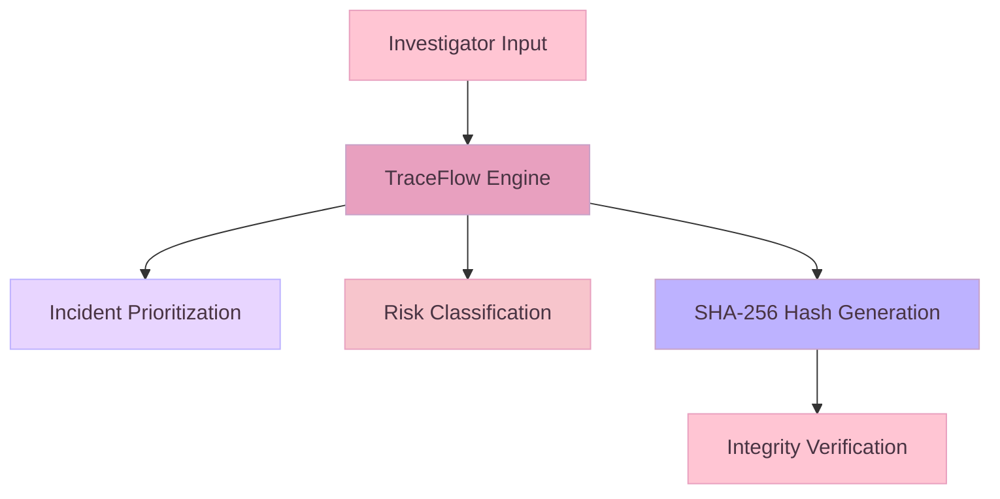

<div align="center">


Cybersecurity app/website in the works. I created this project to show off, develop, and refresh a few skills. I went through a lengthy process, please read the README section for a full analysis. This report will be updated every time a change has been committed within this repository. Thank you. 

<div align="center">


<h3>୨୧ Digital Forensics & Incident Intelligence ୨୧</h3>

<i>Every byte leaves a trace. A Digital Project by Kayla Alexis Hicks <3 </i>


<p align="center">
  
  &nbsp;&nbsp;
  
  &nbsp;&nbsp;
  
  &nbsp;&nbsp;
  
</p>

<h3 align="center">
  ୨୧ Intelligent Digital Forensics & Incident Intelligence Platform ୨୧
</h3>

<p align="center">
  <i>Every byte leaves a trace.</i>
</p>

<p align="center">
  
  
  
  
</p>

<p align="center">
  
  
  
</p>

<p align="center">
  ⊹ ─────────────── ୨୧ ─────────────── ⊹
</p>

<p align="center">
  <a href="#01-about-traceflow">Overview</a> ♡
  <a href="#02-core-functionality">Features</a> ♡
  <a href="#03-technical-architecture">Architecture</a> ♡
  <a href="#07-getting-started">Installation</a> ♡
  <a href="#09-development-roadmap">Roadmap</a>
</p>

---

## 01. About TraceFlow


TraceFlow is a Python-based digital forensics and incident
intelligence application designed to simplify investigative
workflows through automated incident prioritization,
cryptographic hashing, and evidence integrity verification.

The project combines cybersecurity fundamentals with
practical software engineering to explore how technology
can improve the efficiency of digital investigations.

My long-term goal is to establish my own digital forensics
company. TraceFlow represents the beginning of my journey
toward developing independent cybersecurity software.

**Mission:** Investigate intelligently. Preserve evidence.
Follow the trace.

<br clear="both"/>

---

## 02. Core Functionality

| Feature | Description | Status |
|---|---|---|
| Incident Intelligence | Weighted incident prioritization algorithm | Implemented |
| Risk Classification | Automated severity categorization | Implemented |
| Cryptographic Hashing | SHA-256 digital fingerprint generation | Implemented |
| Integrity Verification | Comparison of original and current hashes | Implemented |
| Investigation Dashboard | Interactive graphical interface | Planned |
| Evidence Registry | Organized evidence records | Planned |
| Case Management | Persistent investigation storage | Planned |
| Chain of Custody | Timestamped evidence handling records | Planned |
| Forensic Reporting | Automated investigation reports | Planned |

---

## 03. Technical Architecture

TraceFlow follows a modular software architecture designed
to separate application logic, user interaction, and
persistent data storage.

```text
TraceFlow/
│
├── engine.py              # Intelligence & cryptography
│
├── app.py                 # User interface [Planned]
│
├── database.py            # Data persistence [Planned]
│
├── test_engine.py         # Unit testing [Planned]
│
├── .streamlit/
│   └── config.toml        # Custom interface [Planned]
│
├── screenshots/           # Experimental documentation
│
├── requirements.txt       # Dependencies [Planned]
│
└── README.md              # Project documentation
```

### Application Workflow



---

## 04. Incident Intelligence Engine

The incident prioritization engine utilizes a custom
weighted scoring algorithm to determine the relative
priority of cybersecurity investigations.

The algorithm evaluates three analyst-provided factors.

| Factor | Description | Weight |
|---|---|---:|
| Severity | Seriousness of the incident | 50% |
| Urgency | Time sensitivity of the investigation | 30% |
| Impact | Potential organizational consequences | 20% |

### Weighted Scoring Model

$$
P = (S \times 10) + (U \times 6) + (I \times 4)
$$

Each factor is assigned a numerical value between 1 and 5.

### Python Implementation

```python
def calculate_priority(severity, urgency, impact):
    score = (severity * 10) + (urgency * 6) + (impact * 4)
    return score
```

### Risk Classification Matrix

| Priority Score | Classification |
|---|---|
| 80 - 100 |  |
| 60 - 79 |  |
| 40 - 59 |  |
| 20 - 39 |  |

This scoring model is an educational implementation
and is not an official industry risk scoring standard.

---

## 05. Cryptographic Evidence Analysis


TraceFlow utilizes SHA-256 cryptographic hashing to
generate unique-looking digital fingerprints of supplied
binary data.

SHA-256 produces a 256-bit digest represented by
64 hexadecimal characters.

This functionality supports digital evidence integrity,
one of the foundational principles of digital forensics.

### Hash Generation

```python
import hashlib

def generate_hash(file_data):
    fingerprint = hashlib.sha256(file_data).hexdigest()
    return fingerprint
```

### Integrity Verification

```python
def verify_integrity(original_hash, current_hash):
    if original_hash.lower() == current_hash.lower():
        return True
    else:
        return False
```

### Technical Concepts

- Cryptographic hashing
- SHA-256
- Evidence integrity
- Binary data processing
- Hexadecimal representation
- Deterministic algorithms
- Avalanche effect
- Boolean logic

Matching hashes support integrity verification when
the original reference hash is trustworthy.

---

## 06. Experimental Validation

### Experiment I — Incident Prioritization

Input:

```python
calculate_priority(4, 5, 3)
```

Expected output:

```text
Priority Score: 82/100
Classification: Critical
```

### Experiment II — Cryptographic Hashing

Original data:

```text
Hello
```

Original SHA-256:

```text
185f8db32271fe25f561a6fc938b2e264306ec304eda518007d1764826381969
```

Modified data:

```text
hello
```

Modified SHA-256:

```text
2cf24dba5fb0a30e26e83b2ac5b9e29e1b161e5c1fa7425e73043362938b9824
```

Changing one character produces a substantially different
cryptographic digest, demonstrating the avalanche effect.

### Experiment III — Evidence Integrity

| Test Scenario | Expected Result |
|---|---|
| Original data compared against itself | True |
| Original data compared against modified data | False |

Actual experimental screenshots and test results will
be added throughout development.

<details>
<summary>୨୧ View Backend Source Code</summary>

<br/>

The complete intelligence engine is available in
<a href="engine.py">engine.py</a>.

</details>

---

## 07. Getting Started

### Development Environment

<p align="center">
  
  
  
  
</p>

Download or clone this repository and open the project
directory in Visual Studio Code.

Create a Python virtual environment:

```powershell
py -m venv .venv
```

Execute the backend demonstration:

```powershell
.\.venv\Scripts\python.exe engine.py
```

The current intelligence engine utilizes Python's standard
library and does not require external dependencies.

---

## 08. Technical Skills & Learning Objectives

<table>
<tr>
<td valign="top" width="50%">

### ♡ Programming

- Python development
- Modular programming
- Function-based architecture
- Conditional logic
- Boolean operations
- Algorithm development
- Debugging
- Dependency isolation

</td>
<td valign="top" width="50%">

### ♡ Cybersecurity

- Digital forensics
- Incident triage
- Risk prioritization
- Cryptographic hashing
- Evidence integrity
- Binary data analysis
- Secure development principles
- Technical documentation

</td>
</tr>
</table>

---

## 09. Development Roadmap

TraceFlow is being developed incrementally to establish
a strong foundation in cybersecurity engineering and
independent software development.

### Phase I — Intelligence Engine

- [x] Development environment configuration
- [x] Python virtual environment
- [x] Incident prioritization algorithm
- [x] Automated risk classification
- [x] SHA-256 hashing engine
- [x] Evidence integrity comparison
- [ ] Complete experimental validation

### Phase II — Application Development

- [ ] Interactive Streamlit dashboard
- [ ] Custom feminine cybersecurity interface
- [ ] SQLite database integration
- [ ] Investigation registration
- [ ] Evidence metadata registration
- [ ] Investigation timeline

### Phase III — Forensic Intelligence

- [ ] Simulated chain-of-custody management
- [ ] Automated forensic report generation
- [ ] Comprehensive unit testing
- [ ] Secure storage research
- [ ] Authentication research
- [ ] Application security assessment

---

## 10. Project Limitations

TraceFlow is an educational digital forensics prototype
currently under active development.

It is not intended for production forensic investigations,
legally sensitive evidence, or real client data.

Future development will explore stronger input validation,
authentication, encrypted storage, and tamper-resistant
audit logging.

---

## 11. Documentation & Resources

| Resource | Purpose |
|---|---|
| [Python Documentation](https://docs.python.org/3/) | Python programming |
| [Hashlib Documentation](https://docs.python.org/3/library/hashlib.html) | Cryptographic hashing |
| [SQLite Documentation](https://www.sqlite.org/docs.html) | Database development |
| [Streamlit Documentation](https://docs.streamlit.io/) | Application interface |
| [NIST](https://www.nist.gov/) | Cybersecurity and forensic guidance |

---

## 12. About the Developer

<p align="center">
  
</p>

<h3 align="center">Kayla Hicks</h3>

<p align="center">
  Cybersecurity Student • Morgan State University
  <br/>
  Clara I. Adams Honors College
  <br/>
  Aspiring Digital Forensics Professional
</p>

I am passionate about digital forensics, incident response,
cybersecurity engineering, and developing technology
that solves meaningful problems.

TraceFlow reflects my interest in combining investigative
methodologies with software development and my aspiration
to establish an independent digital forensics company.

<p align="center">
  
  
  
</p>

<p align="center">
  ⊹ ─────────────── ୨୧ ─────────────── ⊹
</p>

<p align="center">
  <sub>Decorative photography by
  <a href="https://www.pexels.com/photo/a-computer-keyboard-on-a-rough-surface-9128858/">Matheus Bertelli — Pexels</a>.
  </sub>
</p>

<p align="center">
  <i>Designed with intention. Developed with curiosity.
  Secured through code.</i>
</p>

<p align="center">
  ₊˚⊹♡ Every byte leaves a trace. ♡⊹˚₊
</p>


